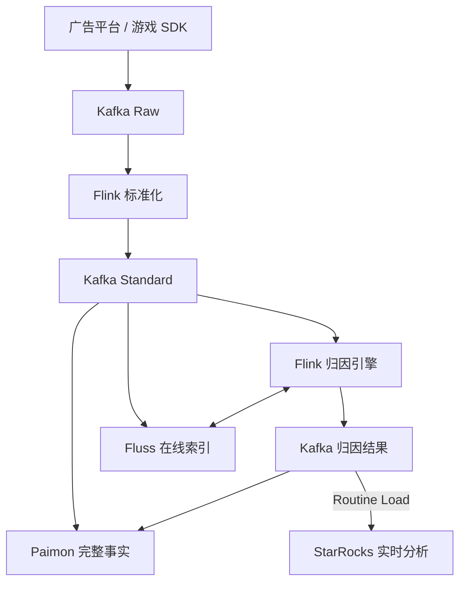

# Game Attribution Engineering

游戏买量归因的大数据工程学习与实现仓库。目标不是把所有大数据组件学一遍，而是围绕游戏发行的买量归因场景，逐步构建一套可运行、可重放、可审计、可修正的实时数据系统。

目标技术栈：

> Kafka + Flink + Fluss + Paimon + StarRocks

- Kafka 负责可靠传输事件。
- Flink 负责流式清洗、短时乱序处理、归因编排与修正。
- Fluss 负责在线点击索引、当前归因映射和在线维表。
- Paimon 负责完整历史、审计、回放与批量重算。
- StarRocks 负责实时分析、漏斗、收入与 ROAS 报表。

## 当前实现

当前实现已经包含三个可独立验收的垂直切片，不包含空壳连接器：

- `attribution-model`：不含原始 PII、带完整 source position 和身份版本的标准事件，以及供归因核心使用的窄模型；
- `attribution-core`：纯 Java、确定性的 7 天 last-touch 归因核心；
- `click-index-spi`：面向 Fluss 的存储无关异步候选查询接口；
- `kafka-ingress`：Flink 2.2 Kafka Source、显式重放起点和完整 `ConsumerRecord` 元数据适配；
- `kafka-egress`：动态 Topic Kafka Record 适配和固定为 `EXACTLY_ONCE` 的事务 Sink；
- `normalize-job`：click/activation v1 严格 JSON 契约、事件级标准化、四类显式 wire encoder、单一跨 Topic 事务 Sink 和可部署 Main；
- `attribution-job`：携带当前决策的 Flink Async I/O 适配器和强制结果分流；
- `golden-tests`：覆盖候选顺序、边界、重复、失败和稳定 tie-break 的归因黄金用例。

Raw Kafka value 可以包含受限的原始身份，但标准事件只输出排序后的 scoped hash、`normalization_version` 和 `key_version`。当前规范化器使用 tenant/game/app scoped SHA-256 作为可运行占位实现；它仍属于 pseudonymous data，生产接入真实玩家标识前必须替换为由运行时密钥服务提供的 HMAC。

四类输出（标准点击、标准激活、拒绝记录、身份规范化问题）先编码成固定的 compact JSON，再汇入同一个 Kafka Sink。Sink 的每个并行 writer 可以在一个 Kafka 事务中写多个 Topic；下游必须使用 `isolation.level=read_committed`。这保证 Flink 从 Checkpoint 恢复时不会向这类消费者暴露未提交事务，但不等于上游业务去重，也不保证多个 Sink subtask 在全局同一瞬间可见。

当前身份摘要仍是无密钥的学习占位实现。`NormalizeJobMain` 默认拒绝启动；只有非生产、非真实玩家数据才能显式设置 `--allow-placeholder-identity-hash=true`。生产接入前必须实现由密钥服务提供的 scoped HMAC，并升级 `key_version`。

```bash
./mvnw -B -ntp clean verify
```

构建后的作业包位于：

```text
flink-jobs/normalize-job/target/normalize-job-0.1.0-SNAPSHOT-job.jar
```

学习环境启动示例（本地 Checkpoint 与占位身份摘要都必须显式放行）：

```bash
bin/flink run --detached \
  -c io.github.zilch404.attribution.normalize.NormalizeJobMain \
  flink-jobs/normalize-job/target/normalize-job-0.1.0-SNAPSHOT-job.jar \
  --bootstrap-servers=kafka:9092 \
  --raw-click-topic=game-attribution.raw.click.v1 \
  --raw-activation-topic=game-attribution.raw.activation.v1 \
  --click-group-id=gae-normalize-click-learning-v1 \
  --activation-group-id=gae-normalize-activation-learning-v1 \
  --start-position=earliest \
  --standard-click-topic=game-attribution.standard.click.v1 \
  --standard-activation-topic=game-attribution.standard.activation.v1 \
  --invalid-topic=game-attribution.normalization.invalid.v1 \
  --identity-issue-topic=game-attribution.normalization.identity-issue.v1 \
  --transactional-id-prefix=gae-normalize-learning-v1- \
  --checkpoint-storage=file:///var/lib/flink/checkpoints/normalize-v1 \
  --parallelism=2 \
  --allow-local-checkpoint-storage=true \
  --allow-placeholder-identity-hash=true
```

生产默认使用 `start-position=committed`：消费组没有已提交 offset 时直接失败，避免 group 拼错后静默全量重放。`earliest`、`timestamp` 和 `committed-or-earliest` 只用于显式 bootstrap/replay。生产环境必须使用 HDFS/S3 等持久 Checkpoint URI，并为每个并发部署分配稳定且唯一的 `transactional-id-prefix`。`transaction-timeout-ms` 必须严格大于 `checkpoint-timeout-ms + max-recovery-duration-ms`，同时 Kafka broker 的 `transaction.max.timeout.ms` 也要允许该值。`max-recovery-duration-ms` 是部署方声明并监控的恢复 SLO，必须覆盖调度、重启和状态恢复的最坏情况，作业本身无法强制实际恢复一定在此时间内完成。SASL/SSL 等配置通过只读的 `--kafka-properties-file` 挂载，文件键使用 `common.`、`consumer.` 或 `producer.` 前缀；不要把密码写入命令行。

更多设计约束见 [`docs/adr/0001-module-boundaries.md`](docs/adr/0001-module-boundaries.md)、[`docs/adr/0002-kafka-ingress-and-replay.md`](docs/adr/0002-kafka-ingress-and-replay.md)、[`docs/adr/0003-kafka-egress-and-normalize-runtime.md`](docs/adr/0003-kafka-egress-and-normalize-runtime.md)、[`docs/event-contract/v1.md`](docs/event-contract/v1.md) 和 [`docs/attribution-rules/v1-last-touch.md`](docs/attribution-rules/v1-last-touch.md)。

## 业务目标

数据来源包括微信小程序、抖音小程序、广点通和巨量平台，主要事件包括：

- 广告点击；
- 启动 / 激活；
- 注册；
- 登录与角色创建；
- 付费与退款；
- 广告平台回传结果。

最终系统需要满足：

- 支持 7 天点击归因窗口；
- 正确处理乱序、重复、迟到和数据回放；
- 支持 last-touch、渠道优先级和版本化规则；
- 点击量再大也不把 7 天数据放进 Flink State；
- 归因结果可以修正，且每一次决策都可解释；
- 新旧链路可以按事件逐条对账；
- 支持实时漏斗、渠道收入、付费率和 ROAS 查询。

## 最终架构



### 组件边界

| 组件 | 负责 | 不负责 |
|---|---|---|
| Kafka | 原始事件、标准事件、重试、修正和结果日志 | 在线随机查询 |
| Flink | Event Time、短时等待、异步 Lookup、规则执行和修正协调 | 保存 7 天全量点击 |
| Fluss | 7～10 天窄点击索引、反向激活索引、当前归因映射 | 长期审计、任意范围分析 |
| Paimon | 全量事实、快照、审计、批量重算和数据修复 | 逐激活低延迟查询 |
| StarRocks | 实时明细、聚合、漏斗、成本和 ROAS 查询 | 归因事务状态机 |
| MySQL CDC | 将业务配置、渠道维表和规则变更转成版本流 | 每条玩家事件同步查询 MySQL |

## 归因核心设计

### 事件契约

标准事件至少包含：

```text
event_id
event_type
event_time
ingest_time
game_id / app_id
platform / channel
click_id / trace_id / install_id
identity_keys[]
schema_version
source_position(topic / partition / offset / record timestamp)
```

需要明确区分：

- 7 天 lookback：业务允许向前查找点击的窗口；
- 几分钟 grace：工程上等待乱序点击的时间；
- State TTL：防止状态泄漏的安全网，不能代替业务定时器。

### Fluss 在线索引

| 表 | 作用 |
|---|---|
| `click_by_id` | 激活能够携带 click token 时直接主键点查 |
| `click_latest_day` | 每个身份、日期、候选类别保存当天最新点击，作为快路径 |
| `click_history_idx` | 保存 7～10 天窄候选索引，作为精确回退路径 |
| `activation_probe` | 迟到点击反查可能受到影响的激活 |
| `activation_work` | 保存 PENDING、RETRY、FINAL 等控制状态 |
| `install_attribution_current` | 当前安装归因，供注册和付费主键查询 |
| `event_pending` | 归因尚未生成时，短期保存待补充的玩家事件 |

实时查询顺序：

1. 有 `click_id/token` 时直接点查；
2. 查询激活当天及前 7 天的 `click_latest_day`；
3. 对无法安全判定的日期 Prefix Lookup `click_history_idx`；
4. 按匹配强度、渠道优先级、点击时间和稳定 tie-break 选择候选；
5. 输出带 `rule_version` 和单调 `decision_version` 的结果。

Fluss 保存的是窄索引。完整广告请求、平台回调和扩展字段只进入 Paimon。绝大多数没有产生激活的点击不会被读取，也不会进入 Flink Checkpoint。

### 迟到与修正

- 激活先进入分钟级 grace，且等待点击索引的 ready watermark；
- Lookup 超时或存储不可用只能进入 `RETRY / UNKNOWN`，不能判为自然量；
- 不支持的身份、冲突数据和永久查询错误进入 `QUARANTINE`，不能无限重试；
- grace 后输出 `FINAL_NORMAL`；
- 超晚点击通过 `activation_probe` 触发 `CORRECTION`；
- Paimon 每小时或每天对近 7～10 天批量重算，作为最终正确性兜底；
- 完整 decision history 进入 Kafka/Paimon，Fluss 和 StarRocks 只物化当前版本。

`attribution-job` 的 Async I/O 输出必须立即经过路由算子：只有 `MATERIALIZE` 进入当前事实 Sink；`RETRY_ONLY`、`QUARANTINE` 和 `NOOP` 分别进入重试、隔离和审计 Side Output。Sink 仍应再次校验 disposition。

## 学习路线

路线按照“先理解正确性，再学习组件，最后完成生产级项目”的顺序推进。

### 阶段 0：归因业务与数据契约

- [ ] 梳理微信、抖音、广点通和巨量的点击与激活链路
- [ ] 定义 last-touch、自然量、归因窗口和渠道优先级
- [ ] 设计统一 `event_id`、时间字段与身份标识
- [ ] 定义重复、乱序、迟到、撤销和规则重算语义
- [ ] 制作覆盖边界条件的黄金样本数据

交付物：事件字典、归因规则说明、黄金样本及期望结果。

### 阶段 1：工程与数据基础

- [ ] Linux、Shell、Git 与 Docker
- [ ] Java、Maven、JUnit 与基础并发编程
- [ ] Python：数据生成、对账和运维脚本
- [ ] SQL：窗口函数、Join、执行计划与索引
- [ ] Parquet、Avro、JSON 与 Schema Evolution
- [ ] 分区、分桶、排序键、压缩和数据生命周期

交付物：本地 Docker Compose 环境和可重复运行的数据生成器。

### 阶段 2：Kafka

- [ ] Topic、Partition、Consumer Group 与 Offset
- [ ] 分区内有序与业务 Key 设计
- [ ] Producer 幂等、事务和 `read_committed`
- [ ] Retention、Log Compaction 与重放
- [ ] Schema 管理、死信队列和重试 Topic
- [ ] 消费延迟、吞吐和热点分区监控

实战：构造点击、激活、注册和付费事件，支持重复发送、乱序和从指定 Offset 重放。

### 阶段 3：Flink 核心

- [ ] DataStream API、算子、并行度和分区
- [ ] Event Time、Watermark、Idle Source 与 Watermark Alignment
- [ ] Keyed State、Timer、Checkpoint 与 Savepoint
- [ ] State Backend、增量 Checkpoint 和恢复流程
- [ ] Async I/O、容量限制、超时、重试和反压
- [ ] Side Output、迟到数据与补偿流
- [ ] Kafka Source/Sink 与端到端幂等
- [ ] Flink CDC 与版本化配置流

实战：实现只保存分钟级 pending activation 的归因状态机，不在 State 中保存 7 天点击。

### 阶段 4：Fluss 在线状态层

- [ ] Primary Key Table 与 Log Table
- [ ] First Row、Versioned Merge 和确定性版本号
- [ ] Partition、Bucket、数据保留与扩缩容
- [ ] Full PK Lookup 与 Prefix Lookup
- [ ] 热 Key、候选放大和 Lookup 性能压测
- [ ] Click Index Ready Watermark
- [ ] Fluss 故障时的重试、积压和恢复策略

实战：完成 `click_by_id`、`click_latest_day`、`click_history_idx` 和 `install_attribution_current`，验证 7 天数据不进入 Flink State。

### 阶段 5：Paimon 历史与重算层

- [ ] Append-Only Table 与 Primary Key Table
- [ ] Snapshot、Changelog、Compaction 与 Schema Evolution
- [ ] 分区、Bucket、对象存储和元数据管理
- [ ] Streaming Write 与 Batch Read
- [ ] 历史回放、规则重算和分区覆盖
- [ ] 原始层、标准层和决策审计层设计

实战：保存完整点击与玩家事件，并从 Paimon 重建 Fluss 在线索引和归因结果。

### 阶段 6：StarRocks 实时分析层

- [ ] Duplicate Key、Primary Key 与 Aggregate 模型
- [ ] Partition、Bucket、Sort Key 与 Prefix Index
- [ ] Kafka Routine Load、幂等 Upsert 和 Conditional Update
- [ ] 物化视图、分区刷新和 Query Rewrite
- [ ] 实时明细、小时/天聚合和查询优化
- [ ] 点击、激活、注册、付费、退款和成本指标

当前 Flink 2.2.1 基线不直接绑定 StarRocks Flink Connector。归因结果先写 Kafka，再由 StarRocks Routine Load 消费；待官方连接器明确支持该 Flink 版本后，再用集成测试评估替换。

实战：构建以下数据集：

- `dwd_install_attribution`
- `dwd_attributed_player_event`
- `dwd_attribution_decision_audit`
- `ads_campaign_hour`
- `ads_campaign_day`

### 阶段 7：完整归因系统

- [ ] `normalize-job`：校验、规范化身份和时间
- [ ] `click-indexer-job`：幂等写入 Fluss 在线索引
- [ ] `attribution-job`：短 grace、异步 Lookup、候选排序和归因决策
- [ ] `correction-job`：处理超晚点击、规则重算和人工修正
- [ ] `event-enrichment-job`：为注册、付费等事件补充安装归因
- [ ] `starrocks-loading`：Routine Load、目标表 DDL 与版本化更新配置
- [ ] `reconciliation-job`：从 Paimon 批量对账和生成修正

### 阶段 8：双跑验证与生产化

- [ ] 新旧链路读取同一份原始输入
- [ ] 以 `activation_id/event_id` 逐条比较最终决策
- [ ] 比较 `matched_click_id`、渠道、计划、素材和自然量状态
- [ ] 比较点击、激活、注册、付费、收入和 ROAS 汇总
- [ ] 将差异分类为身份、时间、规则、维表、迟到或基础设施问题
- [ ] 注入重复消息、Kafka 重放、TaskManager 故障和 Fluss 超时
- [ ] 验证恢复后不丢失、不重复且旧版本不会覆盖修正结果
- [ ] 建立 Kafka Lag、Watermark、Checkpoint、Lookup、State 和归因率监控

## 最终项目验收标准

- [ ] 7～10 天点击没有进入 Flink State 或 Checkpoint
- [ ] 点击索引可以从 Kafka/Paimon 完整重建
- [ ] 所有 Sink 通过稳定业务主键实现幂等
- [ ] 自然量结果能够区分“确定无候选”和“查询失败”
- [ ] 每条结果都能解释所选点击、规则版本和决策原因
- [ ] 迟到点击和历史规则重算能够产生版本化修正
- [ ] 新旧链路经过完整归因窗口后逐事件对账
- [ ] StarRocks 能稳定查询实时漏斗、收入和 ROAS
- [ ] 任意一个分析 Sink 故障不会拖垮核心归因链路

## 当前仓库结构

```text
.
├── common/
│   ├── model/                # 无基础设施依赖的事件模型
│   └── attribution-core/     # 确定性 last-touch 纯函数
├── connectors/
│   ├── click-index-spi/      # 存储无关的异步候选查询端口
│   ├── kafka-ingress/        # Kafka Source 与 ConsumerRecord 元数据
│   └── kafka-egress/         # 动态 Topic EXACTLY_ONCE Kafka Sink
├── flink-jobs/
│   ├── normalize-job/        # 身份规范化与坏数据 Side Output
│   └── attribution-job/      # Flink Async I/O 适配器
├── tests/
│   └── golden-tests/         # 固定时间、可重放的规则样本
├── docs/
│   ├── adr/
│   ├── event-contract/
│   └── attribution-rules/
└── .github/workflows/ci.yml
```

Fluss、Paimon、StarRocks、CDC、修正作业和本地全栈环境会在对应阶段加入；当前不创建没有实现和测试的空模块。

## 官方资料

- [Apache Kafka Documentation](https://kafka.apache.org/documentation/)
- [Apache Flink Documentation](https://nightlies.apache.org/flink/flink-docs-stable/)
- [Apache Flink CDC Documentation](https://nightlies.apache.org/flink/flink-cdc-docs-stable/)
- [Apache Fluss Documentation](https://fluss.apache.org/docs/)
- [Apache Paimon Documentation](https://paimon.apache.org/docs/master/)
- [StarRocks Documentation](https://docs.starrocks.io/)

优先阅读官方文档，并为生产环境固定经过兼容性验证的组件版本，不只追求最新版。

## 暂缓学习的内容

以下技术有价值，但不是当前归因主线的前置条件：

- Hadoop、HDFS、MapReduce 与 YARN；
- Spark、Airflow 与 dbt；
- Iceberg、Delta Lake、Hudi 与 Trino；
- MongoDB、Cassandra 等其他存储。

完成主线项目后，再根据离线计算、编排、多引擎查询或组织数据平台需求补充。

## 学习方式

1. 每个阶段都必须产出可运行代码、测试和观测指标。
2. 正确性测试先于吞吐测试，吞吐测试先于组件扩容。
3. 所有边界案例进入黄金样本，确保规则修改能够自动回归。
4. 使用 Issues 管理任务，使用 Milestones 对应学习阶段。
5. 每完成一个阶段，记录设计选择、失败实验和下一步问题。

## License

This project is licensed under the Apache License 2.0.
