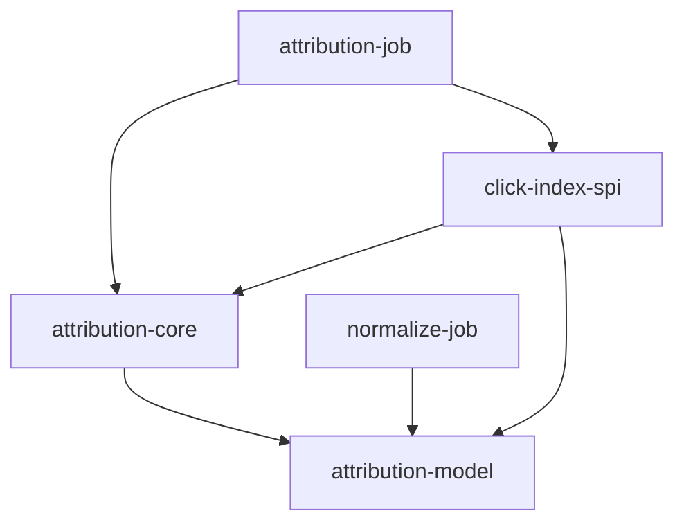

# ADR 0001：归因核心与基础设施解耦

- 状态：Accepted
- 日期：2026-08-09

## 背景

点击日志需要保留 7 天，但绝大多数点击不会产生激活。如果把全部点击放入 Flink State，Checkpoint、恢复和扩缩容成本都会随着点击量增长；如果把查询失败当作无候选，又会把基础设施故障错误标记为自然量。

## 决策

采用以下单向依赖：

1. `attribution-model` 只包含 JDK 类型和不可变领域对象，不依赖 Flink、Fluss 或 JSON 库。
2. `attribution-core` 是纯函数：不读取时钟、不生成 UUID、不访问网络和存储。
3. `click-index-spi` 显式返回索引完整性和水位；空结果不自动等于自然量。
4. `attribution-job` 使用 Flink Async I/O 调用外部索引，输入同时携带激活和当前决策；Flink State 只保留分钟级待定激活。
5. Fluss 保存 7～10 天窄点击索引；Paimon 保存完整事实；StarRocks 只消费归因结果。
6. Async I/O 后强制分流：只有 `MATERIALIZE` 进入事实 Sink，`RETRY_ONLY`、`QUARANTINE` 和 `NOOP` 进入各自 Side Output。

## 版本基线

- Java 17
- Apache Flink 2.2.1
- Maven 3.9.16

Flink 2.2 是当前 Fluss 0.9、Paimon 2.0、Kafka Connector 5.0 和 Flink CDC 3.6 的兼容交集。接入 Kafka 时必须固定完整 artifact 版本 `flink-connector-kafka:5.0.0-2.2`，不能直接沿用 Flink Engine 版本。真实 Fluss/Paimon 适配器将在兼容性和故障语义通过集成测试后加入；StarRocks 首选从 Kafka Routine Load，第一版只固化领域端口。

## 结果

- 同一输入和规则版本可以被确定性回放。
- Lookup 的 PARTIAL、TRUNCATED、INDEX_NOT_READY、TIMED_OUT、FAILED 和 PERMANENT_FAILURE 不会变成自然量。
- 已物化的 FINAL 决策不会被失败查询或不完整候选覆盖；这些评估只产生非物化的重试或隔离信号。
- 候选列表顺序和集合迭代顺序不会影响最终点击；真实 Watermark、grace 与到达序列留给后续 Flink Harness/集成测试验证。
- 结构性算法升级可以并行运行新 engine version，而不需要迁移 7 天 Flink State。

候选适配器若使用行数限制，必须读取 `maxCandidates + 1`，在跨身份合并去重后发现额外候选时返回 `TRUNCATED`。客户端 deadline 必须短于 Flink Async I/O timeout，防止算子超时后底层请求继续无限堆积。
