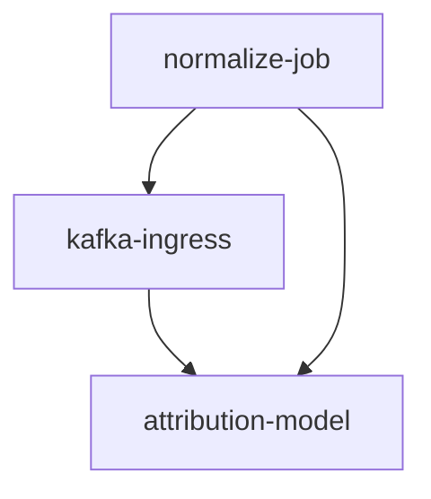

# ADR 0002：Kafka ingress 与可重放标准化

- 状态：Accepted
- 日期：2026-08-09

## 背景

归因核心已经能对完整候选集合做确定性决策，但原始 Kafka 消息尚未形成可执行契约。如果 source position 由 producer 伪造、重放时重新生成 ingest time、坏 JSON 直接抛异常，系统会分别失去审计能力、确定性，或在同一 poison record 上反复重启。

## 决策

1. click 与 activation 使用独立 raw Topic、独立 Flink Kafka Source 和独立 consumer group。
2. Kafka connector 固定为 `flink-connector-kafka:5.0.0-2.2`，与 Flink 2.2.1 基线配套；connector 随最终 Job 打包，Flink core 仍为 `provided`。
3. `kafka-ingress` 只捕获完整 `ConsumerRecord` 内容和 broker 元数据，不解析业务字段；key、payload 和 header value 全部防御性复制，`toString()` 不输出内容。
4. JSON 严格解码和身份规范化属于 `normalize-job`；`attribution-model`、`attribution-core` 不依赖 Kafka、Flink 或 Jackson。
5. raw 身份值在标准化后立即转换成带版本的 scoped hash；canonicalization、`normalization_version` 与 `key_version` 绑定为不可拆分的规则，任何语义或密钥变化都必须升级版本。标准事件使用排序 List。`toCoreEvent()` 只提供现有窄 `ClickEvent` / `ActivationEvent` 评分视图，调用者必须保留标准激活中的 `install_id` 和 `direct_click_id` 用于查询与物化。
6. 已知数据错误进入结构化隔离 Side Output；下游 Collector 或框架异常不能被误分类成坏数据。
7. 标准化作业无状态且不生成 Watermark。后续从 standard Topic 读取时，在 Kafka Source 内从 payload `event_time` 分配每分区 Watermark；不能使用 Kafka timestamp，也不能等分区合并后再统一生成。
8. 生产默认只从 committed offset 启动，group 没有 offset 时 fail fast；bootstrap/replay 才显式使用新 group ID 加 earliest、timestamp 或 committed-or-earliest。
9. Source 强制 `read_committed`、关闭 Kafka auto commit，并要求拓扑在 attach 前启用 Flink Checkpoint；每个 Source 用其独立 group ID 作为 `client.id.prefix`，避免 JMX/指标冲突。

依赖方向：

## 结果

- Topic/partition/offset 来自 broker 事实，而非输入 JSON。
- 同一 Kafka record 重放得到相同标准事件，不读取系统时钟或生成随机 ID。
- malformed、未知版本和 key 不一致不会形成 poison loop。
- 原始身份不会泄露到标准模型、拒绝记录和普通日志。
- click 与 activation 不追求跨 Topic 顺序；后续归因仍依赖 Event Time、索引 ready watermark 和确定性 tie-break。
- 当前拓扑只返回标准事件与隔离流，不创建没有 Sink 的生产 Main。Kafka 标准事件 Sink、事务语义和隔离流持久化将在下一切片实现。
