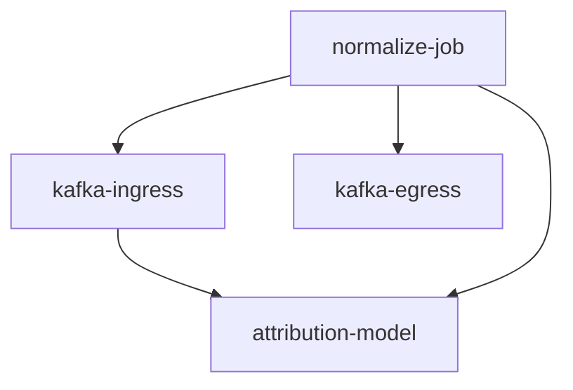

# ADR 0003：Kafka egress 与标准化作业运行时

- 状态：Accepted
- 日期：2026-08-23

## 背景

ADR 0002 已经固定 raw Kafka Source、严格解码和四类 typed output，但没有持久化这些输出。若标准事件、拒绝记录或 identity issue 任意一路没有可靠 Sink，Flink Checkpoint 仍可能推进 raw offset，使审计信息丢失。作业也缺少部署入口、持久 Checkpoint 要求和 Kafka 事务配置边界。

## 决策

1. 新增 `kafka-egress` 模块。它只负责动态 Topic 的 byte record、Kafka 序列化适配、事务配置校验和 `KafkaSink` 构建，不了解归因领域 JSON。
2. `normalize-job` 为标准点击、标准激活、拒绝记录和 identity issue 分别使用显式 v1 encoder。字段名、顺序、enum token、Kafka key 和 JSON Schema 都属于 wire contract；禁止直接反射序列化 Java record。
3. 四路结果编码为 `KafkaOutputRecord` 后 `union`，只连接一个 `DeliveryGuarantee.EXACTLY_ONCE` Kafka Sink。单个 sink writer 的事务可以跨多个 Topic；它仍是每个 subtask 各自提交，不能描述成全局原子事务。
4. Sink 必须配置稳定且在并发部署间唯一的 `transactionalIdPrefix`。生产、预发、重放、blue/green 部署分别使用不同前缀；完全停止旧部署后才能复用。
5. `transaction.timeout.ms` 必须严格大于最大 checkpoint timeout 与部署方声明的最大恢复 SLO 之和，Kafka broker 的 `transaction.max.timeout.ms` 必须允许该值。`max-recovery-duration-ms` 必须覆盖调度、重启和状态恢复的最坏情况并接受监控；Job 无法强制基础设施一定在该时间内恢复。
6. 所有下游 consumer 必须固定 `isolation.level=read_committed`。Exactly-once 只约束 Flink 故障恢复产生的事务重发；上游重复或使用新 group 的主动历史重放仍会形成逻辑重复，后续组件必须依靠稳定业务 ID 幂等。
7. `ProducerRecord.timestamp` 保持 `null`。业务 `event_time` 只存在于 value；历史重放不能把旧业务时间写成 Kafka CreateTime，避免 retention 提前删除刚重放的记录。
8. `NormalizeJobMain` 使用 `getExecutionEnvironment()`，只调用一次 `execute()`，启用 EXACTLY_ONCE Checkpoint、`maxConcurrentCheckpoints=1`、持久 Checkpoint storage 和取消时保留外部 Checkpoint。
9. SASL/SSL 配置只从挂载的 properties 文件读取。命令行、`toString()` 和普通日志不得包含属性值；factory 禁止覆盖 serializer、transactional ID、idempotence、acks 等正确性参数。
10. 当前 scoped SHA-256 是无密钥学习占位。Main 默认 fail closed；非生产测试必须显式放行。本 ADR 不把占位实现描述为生产身份安全方案。
11. `normalize-job` 通过 Maven Shade 生成 job JAR，包含 Kafka connector、Kafka client、Jackson 和内部模块；Flink 集群自带 API 保持 `provided`，保留 service entries，不 relocate Kafka 类。

依赖方向：

## 输出边界

| 输出 | Kafka key | Value 中禁止出现 |
|---|---|---|
| 标准点击 | `click_id` | raw identity、raw payload、header |
| 标准激活 | `activation_id` | raw identity、raw payload、header |
| 拒绝记录 | `topic:partition:offset` | raw key/value/header、异常 message |
| Identity issue | `topic:partition:offset:identity_index` | raw identity type/value |

标准 Topic 和诊断 Topic 必须预配置 delete retention，不启用 compaction；当前 Job 不负责创建或修改 Topic。`source_position` 始终表示原 raw Kafka 位置；标准 Topic 自己的 partition/offset 在下游读取时另行记录，不能覆盖它。

## 结果

- raw offset、标准事件和安全诊断流参加同一套 Flink checkpoint/transaction 生命周期。
- 任一目标 Topic 的 ACL、序列化或发送失败会让作业失败恢复，而不是静默遗漏一路输出。
- Checkpoint interval 同时构成 `read_committed` 可见延迟的主要下界之一。
- 标准化作业仍不保存 7 天点击状态，也不引入 Fluss、Paimon、归因 Watermark 或业务去重状态。
- 真正上线真实玩家数据前仍有明确 blocker：用 KMS/Secret 支持的 scoped HMAC 替换占位 hash，并完成 Kafka 故障注入集成测试。
